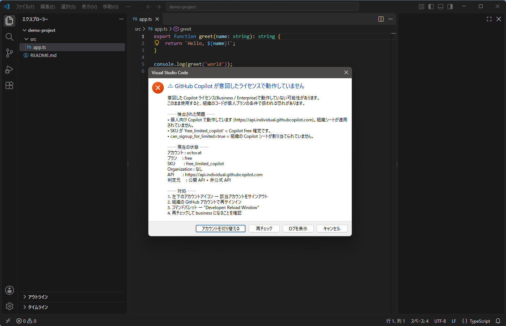
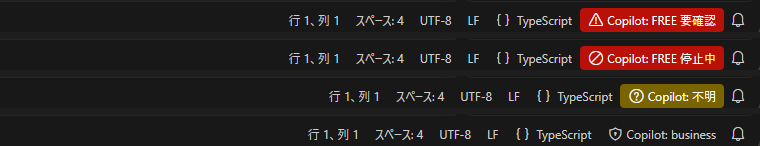
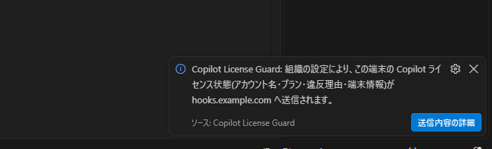
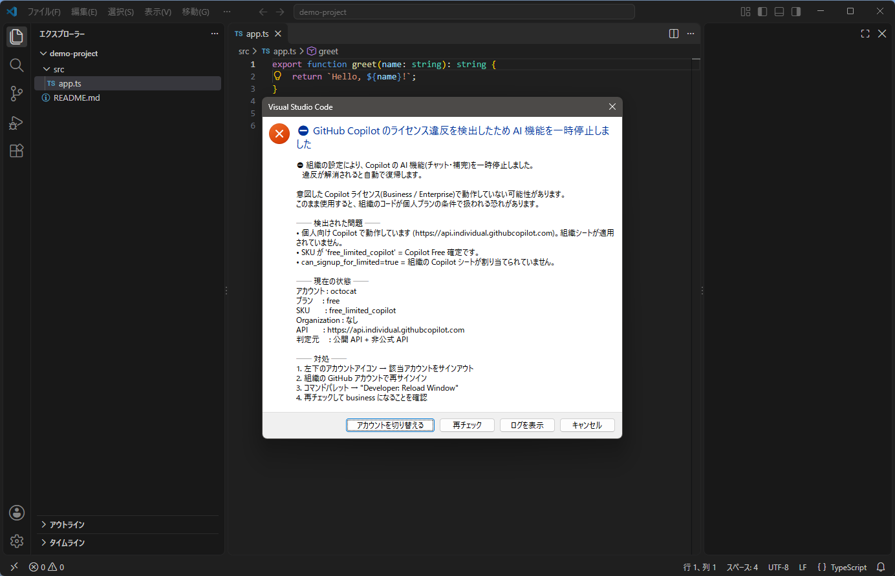
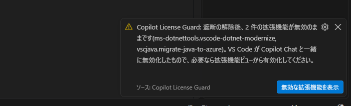

# Copilot License Guard

[](https://github.com/Kuro524/copilot-license-guard/releases/latest)
[](./LICENSE)

GitHub Copilot が **意図した Copilot Business / Enterprise ライセンス**で動作しているかを VS Code 内で常時監視し、
意図せず **Copilot Free** 等の個人プランに落ちている場合にモーダルダイアログで強力に警告する拡張機能です。

> 本拡張は **GitHub, Inc. および Microsoft とは無関係**の非公式ツールです。プラン種別の判定には GitHub の
> **公開 API** を使い、詳細情報の取得に **非公式 API を併用**します（設定で OFF 可）。
> 詳細は「[重要なお知らせ](#重要なお知らせ必ずお読みください)」を必ずお読みください。

> **試験的機能（Experimental）について:** v1.4.0 で追加した管理者向けレポート送信と違反時のソフト遮断は、**どちらも既定で無効**の試験的機能です。
> 設定しない限り従来どおり動作します。有効化する前に「[試験的機能（Experimental）](#試験的機能experimental)」を必ずお読みください。

## 画面イメージ

違反を検出したときのモーダル（既定の動作。表示内容はデモデータ）:



ステータスバーの表示（上から: 違反を検出 / 試験的機能のソフト遮断で停止中 / 判定不能 / 正常）:



> これらの画面は、コマンド **`Copilot License Guard: 警告画面をプレビュー（デモデータ）`** で実際に違反を起こさずに確認できます。

## 目次

- [インストール](#インストール)
  - [方法 A: VS Code の画面から（推奨）](#方法-a-vs-code-の画面からインストール推奨コマンド不要)
  - [方法 B: コマンド 1 行で](#方法-b-コマンド-1-行で)
  - [方法 C: インストールスクリプト](#方法-c-インストールスクリプトcode-の自動検出バージョン固定)
  - [動作確認（初回セットアップ）](#動作確認初回セットアップ)
  - [更新・アンインストール](#更新アンインストール)
  - [うまくいかないとき](#うまくいかないとき)
- [組織内への展開（管理者向け）](#組織内への展開管理者向け)
- [試験的機能（Experimental）](#試験的機能experimental)
  - [管理者向けレポート送信](#管理者向けレポート送信試験的機能)
  - [違反時のソフト遮断](#違反時のソフト遮断試験的機能)
- [重要なお知らせ（必ずお読みください）](#重要なお知らせ必ずお読みください)
- [なぜ必要か](#なぜ必要か)
- [機能](#機能)
- [判定ロジック](#判定ロジック)
- [設定](#設定)
- [コマンド](#コマンド)
- [違反を検出したときの対処](#違反を検出したときの対処)
- [組織管理者向け（併用推奨）](#組織管理者向け併用推奨)
- [送信されるデータ / プライバシー](#送信されるデータ--プライバシー)
- [開発者向け（ソースからビルド）](#開発者向けソースからビルド)
- [ライセンス](#ライセンス)

---

## インストール

**必要なもの:** VS Code 1.90 以上（Windows / macOS / Linux）。
管理者権限・Node.js・GitHub CLI は **不要**です。

本拡張は Visual Studio Marketplace では配布しておらず、**GitHub Releases の VSIX ファイル**として配布しています。
最新版はこちら → **<https://github.com/Kuro524/copilot-license-guard/releases/latest>**

| 方法 | 向いている人 | 必要なもの |
|---|---|---|
| [A. VS Code の画面から](#方法-a-vs-code-の画面からインストール推奨コマンド不要) | **ほとんどの方**。コマンドを使わずに入れたい | ブラウザと VS Code だけ |
| [B. コマンド 1 行](#方法-b-コマンド-1-行で) | ターミナルに慣れている方 | `code` コマンド |
| [C. スクリプト](#方法-c-インストールスクリプトcode-の自動検出バージョン固定) | 複数台への配布、バージョン固定、`code` が PATH に無い環境 | PowerShell または bash |

### 方法 A: VS Code の画面からインストール（推奨・コマンド不要）

1. [最新リリース](https://github.com/Kuro524/copilot-license-guard/releases/latest)の **Assets** にある
   **`copilot-license-guard.vsix`** をダウンロードします。
   （直接リンク: <https://github.com/Kuro524/copilot-license-guard/releases/latest/download/copilot-license-guard.vsix>）
2. VS Code を開き、左のアクティビティバーから **拡張機能** ビューを開きます（`Ctrl+Shift+X` / macOS は `Cmd+Shift+X`）。
3. ビュー右上の **`…`**（「ビューとその他のアクション」）メニュー → **「VSIX からのインストール...」**
   （英語 UI では **Install from VSIX...**）を選び、1. でダウンロードしたファイルを指定します。
4. 「拡張機能が正常にインストールされました」と表示されたら、案内に従って **VS Code を再読み込み**します。
5. [動作確認](#動作確認初回セットアップ)へ進みます。

### 方法 B: コマンド 1 行で

VSIX をダウンロードして `code --install-extension` に渡すだけです。
既にインストール済みでも同じコマンドで上書き更新されます（`--force`）。

**Windows（PowerShell）**

```powershell
irm https://github.com/Kuro524/copilot-license-guard/releases/latest/download/copilot-license-guard.vsix -OutFile copilot-license-guard.vsix; code --install-extension copilot-license-guard.vsix --force
```

**macOS / Linux**

```bash
curl -fL -o copilot-license-guard.vsix https://github.com/Kuro524/copilot-license-guard/releases/latest/download/copilot-license-guard.vsix && code --install-extension copilot-license-guard.vsix --force
```

> `code` コマンドが見つからないと言われる場合は[うまくいかないとき](#うまくいかないとき)を参照してください
> （方法 A ならコマンドは不要です）。

### 方法 C: インストールスクリプト（`code` の自動検出・バージョン固定）

リポジトリ同梱の [`install.ps1`](./install.ps1)（Windows）/ [`install.sh`](./install.sh)（macOS / Linux）は、
「VSIX のダウンロード → `code` コマンドの検出（PATH に無くても既定のインストール先を探索）→ インストール → 結果確認」を自動で行います。
バージョン固定（`-Version` / `--version`）や VS Code Insiders へのインストール（`-Insiders` / `--insiders`）にも対応しています。

**Windows（PowerShell）**

```powershell
irm https://raw.githubusercontent.com/Kuro524/copilot-license-guard/main/install.ps1 -OutFile install.ps1
.\install.ps1                      # 最新版をインストール
.\install.ps1 -Version v1.3.0      # バージョンを固定
.\install.ps1 -Insiders            # VS Code Insiders へ
.\install.ps1 -CodePath "C:\Program Files\Microsoft VS Code\bin\code.cmd"   # code の場所を明示
```

> 実行ポリシーで止められる場合は `powershell -ExecutionPolicy Bypass -File .\install.ps1` のように実行してください。

**macOS / Linux**

```bash
curl -fsSL https://raw.githubusercontent.com/Kuro524/copilot-license-guard/main/install.sh -o install.sh
bash install.sh                    # 最新版をインストール
bash install.sh --version v1.3.0   # バージョンを固定
bash install.sh --insiders         # VS Code Insiders へ
```

スクリプトが通信するのは GitHub のみです（`github.com` と、VSIX の配信先 `*.githubusercontent.com`、
最新バージョン名の表示用 `api.github.com`。後者は失敗しても続行します）。
内容を確認してから実行することを推奨します。

### 動作確認（初回セットアップ）

1. VS Code を再読み込みすると、**初回のみ**「**Copilot License Guard が GitHub を使用してサインインしようとしています**」
   という同意ダイアログが表示されます。**「許可 (Allow)」** を押してください。
   これは拡張が VS Code の GitHub セッショントークンを読み取るために必要です
   （`vscode.authentication.getSession` は `silent: true` では「既に許可済みの拡張」にしかセッションを返さないため）。
   一度許可すれば以降は自動でサイレント取得されます。
2. 右下のステータスバーを確認します。

   | 表示 | 意味 |
   |---|---|
   | `Copilot: business`（または `enterprise`）＋盾アイコン | **正常**。法人シートで動作しています |
   | `Copilot: FREE 要確認`（赤背景） | **違反を検出**。[対処](#違反を検出したときの対処)を参照 |
   | `Copilot: 不明` | 判定できていません。クリックして再チェック（同意ダイアログを閉じてしまった場合もここから再要求できます） |

3. 判定の詳細は **出力パネル**（表示 → 出力）で「**Copilot License Guard**」を選ぶと確認できます。

### 更新・アンインストール

- **更新:** VSIX 配布のため **自動更新は行われません**。新しいバージョンが出たら、インストールと同じ手順をもう一度実行してください（上書きされます）。
  現在のバージョンは `code --list-extensions --show-versions` の `Kuro524.copilot-license-guard@x.y.z` で確認できます。
  リポジトリを **Watch → Custom → Releases** にしておくと新バージョンの通知を受け取れます。
- **アンインストール:** 拡張機能ビューで「Copilot License Guard」→ アンインストール、
  または `code --uninstall-extension Kuro524.copilot-license-guard`。

### うまくいかないとき

| 症状 | 対処 |
|---|---|
| `code` コマンドが見つからない（`'code' は認識されていません` / `command not found`） | **macOS:** VS Code でコマンドパレット（`Cmd+Shift+P`）→ `Shell Command: Install 'code' command in PATH` を実行。**Windows:** 通常はインストーラーが PATH に追加します。無い場合は `& "$env:LOCALAPPDATA\Programs\Microsoft VS Code\bin\code.cmd" --install-extension copilot-license-guard.vsix --force`（ユーザーインストール。システムインストールは `"C:\Program Files\Microsoft VS Code\bin\code.cmd"`）のようにフルパスで実行するか、[方法 C](#方法-c-インストールスクリプトcode-の自動検出バージョン固定) を使ってください。[方法 A](#方法-a-vs-code-の画面からインストール推奨コマンド不要) ならコマンド自体が不要です |
| 「VSIX からのインストール...」が見当たらない | 拡張機能ビューの**右上** `…` メニューの中にあります。表示されない場合は VS Code を最新版に更新してください |
| 同意ダイアログを閉じてしまった / `Copilot: 不明` のまま | ステータスバーの項目をクリックするか、コマンドパレットで `Copilot License Guard: 今すぐライセンスを確認` を実行すると再度許可を求めます |
| プロキシやフィルタで `github.com` からダウンロードできない | VSIX の実体は `*.githubusercontent.com` から配信されます（許可リストに追加が必要な場合があります）。ブラウザで Releases ページから VSIX を取得し、[方法 A](#方法-a-vs-code-の画面からインストール推奨コマンド不要) でインストールするか、ローカルに置いた VSIX を `code --install-extension <パス> --force` で指定してください（UNC パス `\\server\share\...` は直接指定できないため、いったんローカルにコピーします） |
| 拡張機能が「組織で許可されていない」旨の表示で無効になる | 組織が VS Code の `extensions.allowed` で拡張機能を制限しています。管理者に `Kuro524.copilot-license-guard`（または publisher `Kuro524`）の許可を依頼してください |
| ステータスバーに何も出ない | 設定 `copilotLicenseGuard.enabled` / `copilotLicenseGuard.statusBar` が `false` になっていないか確認してください。制限モード（信頼されていないワークスペース）でも v1.3.0 以降は動作します |
| Remote-SSH / WSL / Dev Container で動かない | v1.3.0 以降は UI 拡張として**ローカル側**で動作するため、リモート側へのインストールは不要です。ローカルの VS Code にインストールされているか確認してください（ブラウザ版の Codespaces / vscode.dev は非対応です） |

---

## 組織内への展開（管理者向け）

開発者全員に導入する場合の手順と推奨設定です。

### 1. 配布

- [方法 B](#方法-b-コマンド-1-行で) / [方法 C](#方法-c-インストールスクリプトcode-の自動検出バージョン固定) のコマンドを、
  ログオンスクリプト・Intune / Jamf / Ansible などの構成管理ツールから実行します（ユーザー権限で可）。
- **バージョンを固定**して配布する場合は `latest` ではなく明示的な URL を使います。
  `https://github.com/Kuro524/copilot-license-guard/releases/download/v1.3.0/copilot-license-guard.vsix`
- **インターネットに出られない端末**向けには、VSIX を社内の配布サーバーや共有フォルダーに置いて配布します。
  `code --install-extension` は UNC パス（`\\server\share\...`）を直接受け付けないため、いったんローカルにコピーしてから指定します。

  ```powershell
  Copy-Item \\server\share\copilot-license-guard.vsix $env:TEMP
  code --install-extension "$env:TEMP\copilot-license-guard.vsix" --force
  ```

- VS Code の拡張機能許可リスト（設定 `extensions.allowed`）を運用している場合は、
  `"Kuro524.copilot-license-guard": true` を追加してください。

### 2. 推奨設定（ユーザー設定またはポリシーで配布）

本拡張の設定はすべて **ユーザー（アプリケーション）スコープ**です。ワークスペース（リポジトリ内の `.vscode/settings.json`）からは
変更できないため、開いたリポジトリの設定によって監視が無効化されることはありません。
配布はユーザー設定（`settings.json`）、または VS Code のポリシー機能で行ってください。

```json
{
  "copilotLicenseGuard.requireOrganization": "my-org",
  "copilotLicenseGuard.checkIntervalMinutes": 30
}
```

- `requireOrganization` に **自組織の GitHub Organization login** を設定すると、
  「法人シートではあるが別の組織のシート」というケースも検出できます。
- 非公式 API の利用がポリシー上問題になる場合は `"copilotLicenseGuard.useInternalApi": false` を追加します
  （主判定は公開 API のみで継続します）。
- モーダルダイアログが業務を妨げる場合は `"copilotLicenseGuard.modalWarning": false` で通知のみにできます。

設定項目の一覧は[設定](#設定)を参照してください。

### 3. 更新の運用

VSIX 配布のため自動更新されません。新しいリリースが出たら配布コマンドを再実行してください（`--force` で上書きされます）。
リリースの通知はリポジトリを **Watch → Custom → Releases** で受け取れます。

### 4. 導入審査に使える資料

- [PRIVACY.md](./PRIVACY.md) — 送信されるデータ・宛先・保存されるものの一覧
- [THIRD-PARTY-NOTICES.md](./THIRD-PARTY-NOTICES.md) — 同梱サードパーティコードは **0 件**（実行時依存なし）
- [判定ロジック](#判定ロジック) — 使用する API と判定の根拠
- VSIX は GitHub Actions が公開ソースからビルドして Release に添付しています（[ワークフロー](./.github/workflows/build.yml)）

---

## 試験的機能（Experimental）

v1.4.0 で追加した以下の 2 機能は **試験的機能**です。安定版に同梱されていますが、**どちらも既定で無効**で、設定しない限り従来どおり動作します。

| 項目 | 内容 |
|---|---|
| 位置づけ | 挙動やレポートの形式（`schema`）は今後のマイナーバージョンで変わる可能性があります。**少人数でパイロットしてから**展開してください |
| 既定の挙動 | **両機能とも既定で無効。** 設定しない限り v1.3.0 と同じ動作です |
| 設定の配布 | 両機能の設定はワークスペース（リポジトリ）からは変更できません。いずれも application スコープで、`report.*` は Settings Sync の対象外（`ignoreSync`）です。リモート（WSL / SSH / Dev Container）のウィンドウでもローカルのユーザー設定が使われ、`devcontainer.json` 等のリモート設定からは変更できません |
| 見え方の確認 | コマンド **`Copilot License Guard: 警告画面をプレビュー（デモデータ）`** で、利用者に表示されるモーダル・ステータスバー・通知をデモデータで再現できます（実際の判定や設定は変更しません） |

### 管理者向けレポート送信（試験的機能）

チェック結果を、組織が用意した HTTPS の受け口（Slack Incoming Webhook・Teams Workflows・Azure Functions・SIEM など）へ POST します。
クライアント側の検知を**記録として残す**ための機能で、受け側で「一定時間ハートビートが無い端末＝拡張が止められた／許可を押していない」も検知できます。

| 設定キー（`copilotLicenseGuard.`） | 既定 | 説明 |
|---|---|---|
| `report.url` | `""` | 送信先。**空なら送信しません。** `https://` のみ（`localhost` は `http://` 可）。認証情報を URL に埋め込まないでください |
| `report.headers` | `{}` | 追加ヘッダー（`Authorization` 等）。値はログに出ません |
| `report.format` | `"json"` | `json`（構造化、schema=1）／`slack`（`{ "text": "..." }`） |
| `report.events` | 全部 | `violation` / `recovered` / `unknown` / `heartbeat` / `enforcement` / `monitoringDisabled` |
| `report.heartbeatHours` | `24` | ハートビート間隔（±10% のジッター付き） |
| `report.deviceFields` | `["hostname","installId"]` | 端末情報。`osUser`（OS ユーザー名。実名を含むことがある）は明示した場合のみ |

**送信タイミング**: 違反は内容が変わったとき（同じ内容なら 24 時間ごと）、違反→正常で `recovered`、判定不能への遷移で `unknown`、
遮断の適用/解除/上書き検知で `enforcement`（設定変更の前に記録し、拡張ホストの再起動をまたいでも次回チェックで送ります。遅延分には `deferred: true` が付きます）、
`copilotLicenseGuard.enabled` を false にしたとき `monitoringDisabled`、それに定期の `heartbeat`。`recovered` は途中に判定不能を挟んでも、未解消の違反があれば送ります。
送信の成否は判定や表示に影響しません（失敗時は 1 回だけ再送、`429` は `Retry-After` を尊重）。

**送る内容**（`json` の例。[PRIVACY.md](./PRIVACY.md#5-試験的機能-管理者向けレポート送信) に全項目）:

```json
{ "schema": 1, "event": "violation", "eventId": "<送信ごとに一意な UUID>", "dedupeKey": "<同じ出来事なら同じ値 (32 桁の hex)>", "seq": 12, "timestamp": "2026-10-28T09:00:00.000Z",
  "status": "violation", "account": "octocat", "plan": "free", "tier": "individual", "sku": "free_limited_copilot",
  "violationCodes": ["individual_tier", "free_sku"], "violations": ["個人向け Copilot エンドポイントで動作しています(組織シート未適用)", "SKU が free_limited_copilot (Copilot Free 確定)"],
  "requiredOrganization": "my-org", "requiredOrgMatch": false, "enforcementMode": "warn", "enforcementActive": false,
  "extension": { "id": "Kuro524.copilot-license-guard", "version": "1.4.0" },
  "vscode": { "version": "1.143.1", "remoteName": null },
  "device": { "hostname": "PC-0123", "installId": "…" } }
```

送らないもの: トークン、ソースコード・ファイル・パス、プロンプト、所属 Organization の一覧（必須 Organization との一致だけを送ります）。
`violations` の文言は違反コードから生成した定型文で、画面に出る文言（組織名やエンドポイントなどの実データを含む）はそのまま送りません。
`installId` は本拡張が生成するランダムな識別子で、VS Code の machineId ではありません。

**設定例（Slack）**

```json
{
  "copilotLicenseGuard.report.url": "https://hooks.slack.com/services/XXX/YYY/ZZZ",
  "copilotLicenseGuard.report.format": "slack"
}
```

設定後、コマンドパレットの **`Copilot License Guard: レポート送信をテスト（試験的機能）`** で `event: "test"` を送って疎通を確認できます。
送信が有効な端末では、利用者に「この端末の状態が `<host>` へ送信されます」と **1 回だけ通知**します（透明性のため）。



**限界（必ずお読みください）**

- 送信元は利用者自身の VS Code です。**認証されていない自己申告**であり、監査証跡の代替にはなりません（受け口側で `report.headers` の鍵を検証しても、利用者はその鍵を読めます）。
- 利用者が拡張を無効化すれば送信も止まります → `heartbeat` を有効にし、受け側で無音を検知してください。
- 複数ウィンドウを開いていると同じ出来事が重複して届くことがあります（直前 60 秒の重複は抑制）。`eventId` は送信ごとに一意なので、
  **重複排除には `dedupeKey`**（同じ出来事なら同じ値。違反→復帰→再違反や 24 時間後の再送は別の値になります）を使ってください。
- リダイレクトは追いません（別ホストへヘッダーや本文が流れるのを防ぐため）。受け口は直接 200 系を返す URL にしてください。

### 違反時のソフト遮断（試験的機能）

`"copilotLicenseGuard.enforcement": "disableAI"` にすると、違反を**明確な証拠**で検出している間、
VS Code の公式設定 **`chat.disableAIFeatures`**（VS Code 1.104 以降。「GitHub Copilot のチャットと補完を含む組み込み AI 機能を無効化して隠す」）を
**ユーザー設定で `true`** にし、違反が解消されると元の値に戻します。



| 設定キー（`copilotLicenseGuard.`） | 既定 | 説明 |
|---|---|---|
| `enforcement` | `"warn"` | `"disableAI"` で遮断を有効化 |
| `enforcementOnUnknown` | `false` | `true` なら判定不能が **15 分以上**続いた場合も遮断（オフライン時も止まる厳格運用） |

**遮断の根拠にする違反（明確な証拠）**: 個人向けエンドポイント（`individual_tier`）、既知の個人プラン名、`free_limited_copilot` SKU、
Free のクォータ・シート未割当シグナル、必須 Organization の非メンバー（404）／別組織のシート、アカウント不一致。
**根拠にしない違反**: 未知のエンドポイント・SKU・プラン名、`allowedPlans` の設定ミス、組織一覧が空、参加未完了（pending）。
これらは警告にとどめます（GitHub 側の文字列変更 1 つで全端末の AI 機能が止まる事故を避けるため）。

**動作の要点**

- 元の値は設定を書き換える**前**に記録し、以後は上書きしません（自分が書いた `true` を元値と誤認しない）。復元は「自分が書いた `true` が残っている場合」だけ行います。
- 判定不能（同意未取得・API 障害）では既定で**現状維持**です。遮断中なら、正常を確認するまで解除しません（fail-safe）。
- `chat.disableAIFeatures` を切り替えると VS Code は Copilot Chat を無効化／再有効化し、**拡張ホストを再起動**します（デバッグセッションや言語サーバーが中断します）。
  往復を防ぐため、変更は前回から 5 分以上空け、1 時間に 4 回までに制限しています。
- 遮断状態が他端末へ同期されないよう、`settingsSync.ignoredSettings` に `chat.disableAIFeatures` を追加します（自動では外しません）。
- ステータスバーは `Copilot: FREE 停止中`、モーダルの先頭に「⛔ … AI 機能を一時停止しました」と表示します。
- **`Copilot License Guard: 遮断を一時停止 / 初期化（試験的機能）`** コマンドで、60 分／180 分の一時停止（ログとレポートに記録）、または記録の初期化（復旧用）ができます。
  一時停止は期限付きで、違反が続いていれば期限後に再適用されます。
- `enforcement` を `warn` に戻す／`copilotLicenseGuard.enabled` を false にすると、遮断中であれば解除します。

**限界（必ずお読みください）**

- **強制ではなく「摩擦＋記録」です。** 利用者はユーザー設定を手で戻せます（次回チェックで再適用）。
- **VS Code は Copilot Chat 拡張を無効化しようとし、依存する拡張があると確認ダイアログを出します**（実測 1.143:
  「'GitHub Copilot Chat' 拡張機能のみを無効にすることはできません。'GitHub Copilot modernization for .NET'、'GitHub Copilot modernization'、その他の拡張機能がこれに依存しています。これらの拡張機能をすべて無効にしますか?」）。
  利用者が**キャンセル**しても設定は true のままなので Chat の UI は隠れますが、拡張自体は有効のまま残ります。
  **「すべて無効にする」**を選ぶと依存拡張も無効化され、**違反解消後に VS Code が再有効化するのは Copilot Chat だけ**です。
  本拡張は適用時に読み込まれていた拡張を記録し、復帰後に無効のまま残った拡張を通知します（「無効な拡張機能を表示」で `@disabled` を開きます）。

  
- **利用者が Copilot Chat を手で有効化すると、VS Code が `chat.disableAIFeatures` を自動で false に戻します**（上記ダイアログに答えた瞬間にも一時的に起きます）。
  本拡張は次回チェックで再適用し、レポートに `reapply` として残ります（前回変更から 5 分・1 時間 4 回の上限内）。
- `chat.disableAIFeatures` は window スコープのため、開いているワークスペースの `.vscode/settings.json`（VS Code の「このワークスペースで AI 機能を有効にする」操作を含む）や
  リモート設定で `false` が指定されていると無効化できません。本拡張はこれを検知してツールチップとレポート（`overriddenBy`）に出しますが、リポジトリ側の設定は書き換えません。
- VS Code のプロファイルごとに設定は別です。拡張が入っていないプロファイルでは働きません。
- VS Code 1.104 未満では設定が存在しないため遮断は機能しません（警告のみ。起動ログに注意を出します）。
- Settings Sync の除外に追加する前に同期が走った場合など、他端末に `true` が波及する可能性はゼロではありません。
- **復旧手順（拡張を無効化・削除した後も AI 機能が止まったままのとき）**: ユーザー設定の `chat.disableAIFeatures` を削除（または `false`）し、
  拡張機能ビューで **GitHub Copilot Chat** が無効化されていれば有効化してください。拡張が入っている場合は上記コマンドの「初期化」でも戻せます。

---

## 重要なお知らせ（必ずお読みください）

### プラン種別の判定は GitHub の**公開 API** で行います

本拡張は Business/Enterprise か個人プランかの判定に、GitHub が公開している
GraphQL API のフィールド **`viewer.copilotEndpoints.api`** を使用します。
これは GitHub が公開しているスキーマ
([schema.docs.graphql](https://docs.github.com/public/fpt/schema.docs.graphql)) に
`@docsCategory(name: "copilot")` 付きで掲載された正式なフィールドで、
**管理者権限は不要**です。

### 詳細情報の取得には非公式 API を併用します（任意・OFF 可能）

プラン名（`free` / `individual_pro` / `business` 等）・SKU・シート提供元組織といった
**詳細情報**は、公開 API では取得できません。これらは GitHub の内部エンドポイント
`GET https://api.github.com/copilot_internal/user` から取得しています。

- このエンドポイントは **GitHub から公式にドキュメント化・サポートされていません**。
  予告なく仕様変更・廃止される可能性があります。
- **廃止されても主判定は公開 API で継続します。** 違反時の説明が簡素になるだけです。
- 非公開 API の利用が組織ポリシー上問題になる場合は、設定
  **`copilotLicenseGuard.useInternalApi` を `false`** にしてください。
- 本拡張は **GitHub, Inc. および Microsoft とは無関係**であり、これらによる承認・提供・
  サポートを受けたものではありません。

### 公開 API のみでは判別できないこと

- **Free / Student / Pro / Pro+ / Max の区別**（いずれも `api.individual.githubcopilot.com` になります）
- **Business と Enterprise の区別**（いずれも `api.business.githubcopilot.com` になります）
- **どの組織が Copilot シートを提供しているか**

本拡張の主目的である「**法人シートで動いているか否か**」の判定には影響しません。

### 免責

本拡張は MIT ライセンスに基づき **「現状有姿（AS IS）」** で提供されます。
判定結果の正確性・可用性はいかなる形でも保証されません。
**ライセンスコンプライアンスの最終的な確認は、必ず組織の正規の管理画面
（GitHub Organization の Copilot 設定・課金画面）で行ってください。**
本拡張はあくまで**事故の早期検知を補助するもの**であり、監査証跡の代替にはなりません。

業務環境へ広く展開する前に、非公開 API の利用について自組織のポリシー・
GitHub との契約条件に照らして問題がないかご確認ください。
懸念がある場合は `copilotLicenseGuard.useInternalApi` を `false` にすれば、
**公開 API のみで動作**します。

---

## なぜ必要か

GitHub 側には **「組織メンバーに Copilot Free の利用を禁止する」設定が存在しません**（2026-10 時点）。
Copilot のポリシーは組織・企業のシートを持つユーザーにしか及ばず、組織シートが未割当・剥奪されたユーザーが
個人の Free プランで Copilot を使うことを、GitHub プラットフォーム側で技術的にブロックする手段はありません
（例外は Enterprise Managed Users で、管理対象アカウント自体が個人プランに加入できません）。

そのため **クライアント側での検知と警告が現実的な唯一の対処法**になります。

### 意図せず Free になる主な原因

| 原因 | 本拡張の検知方法 |
|---|---|
| VS Code が個人アカウントでサインインしている | VS Code のサインインアカウントと API 応答の不一致を検出 |
| 組織の Copilot シートが剥奪された | 次回トークン更新（約30分）で SKU が `free_limited_copilot` に変化するのを検出 |
| シート未割当のまま Free で使い始めた | `can_signup_for_limited=true` / `organization_login_list` が空 |
| 複数アカウントの取り違え（EMU と個人など） | アカウント切替イベントを捕捉して即再検査 |

---

## 機能

- **起動時チェック** — VS Code 起動完了時に自動検査
- **定期チェック** — 既定 30 分間隔（Copilot トークンの更新周期に合わせる）
- **アカウント切替の即時検知** — `authentication.onDidChangeSessions` を購読し、
  サインイン/サインアウトの瞬間に再検査
- **モーダル警告** — 違反時は操作をブロックするダイアログを表示（対処手順つき）
- **ステータスバー表示** — 現在のプランを常時表示。違反時は赤背景
- **出力パネルの監査ログ** — `出力 > Copilot License Guard`
- **制限モード・仮想ワークスペース・リモート開発に対応** — ワークスペースのファイルには一切アクセスしないため、
  信頼されていないワークスペースでも監視を継続します。Remote-SSH / WSL / Dev Container / Codespaces（VS Code デスクトップから接続した場合）では
  ローカル側（UI 拡張）で動作し、リモート側へのインストールは不要です
- **設定はユーザースコープのみ** — 本拡張の設定（監視の有効/無効・許可プラン等）はリポジトリ内の `.vscode/settings.json` から変更できません
  （試験的機能の遮断が書き換える VS Code 側の設定 `chat.disableAIFeatures` はこの限りではありません。[詳細](#違反時のソフト遮断試験的機能)）

---

## 判定ロジック

### 1. 主判定 — 公開 GraphQL API（常に実行）

VS Code が保持する GitHub セッションのトークンで、公開 GraphQL API を照会します。

```graphql
{ viewer { login copilotEndpoints { api } } }
```

返される `api` のホスト名からプラン種別を判定します（実測値）。

| `copilotEndpoints.api` | 判定 |
|---|---|
| `https://api.business.githubcopilot.com` | **法人**（Business / Enterprise） |
| `https://api.enterprise.githubcopilot.com` | **法人** |
| `https://api.individual.githubcopilot.com` | **個人**（Free / Student / Pro / Pro+ / Max）→ 既定では違反 |
| `https://api.githubcopilot.com`（旧形式） | **個人** → 既定では違反 |
| 上記以外・取得失敗 | **不明** → 許可外に倒す（fail-safe） |

`*.githubcopilot.com` で終わらないホストは、サフィックス偽装を避けるため必ず「不明」になります。

### 2. 詳細判定 — 内部 API（`useInternalApi: true` のときのみ）

```
GET https://api.github.com/copilot_internal/user
```

| フィールド | 判定 |
|---|---|
| `copilot_plan` | `allowedPlans` に無ければ違反 |
| `access_type_sku` | `free_limited_copilot` = **Free 確定** |
| `limited_user_quotas` | non-null = Free のクォータ制限下 |
| `can_signup_for_limited` | `true` = 組織シート未割当 |
| `organization_login_list` | 空 = 組織経由で使っていない |

未知の SKU は `unknown` として**許可外（＝警告）に倒します**（fail-safe）。
このステップが失敗しても、1. の判定結果はそのまま有効です。

### 3. Organization の確認（`requireOrganization` 設定時のみ）

内部 API から `organization_login_list`（＝**シート提供元**）が取れていればそれで照合します。
取れない場合は公開 REST API で**所属だけ**を確認します。

```
GET https://api.github.com/user/memberships/orgs/{org}
```

| 応答 | 扱い |
|---|---|
| `200` + `state: active` | 所属を確認（ただし「その組織がシートを提供しているか」までは不明） |
| `200` + `state: pending` | 参加未完了 → 違反 |
| `404` | メンバーではない → 違反 |
| `403` など | **確認不能**（IP 許可リスト / SAML SSO 未認可）→ **違反にしません** |

> **Organization owner 権限は不要です。** これは「**自分自身の**メンバーシップ」を返す
> 自己参照 API で、必要なのは OAuth スコープ（一般メンバーが自分で付与できるもの）だけです。
> GitHub が返す受理スコープは実測で
> `admin:org, read:org, repo, user, write:org` であり、`admin:org` は要求されません。
>
> 対照的に、組織管理者向けの `GET /orgs/{org}/members/{username}/copilot`
> （シート割当状況を返す）は **`admin:org` が必須**で、一般開発者は自分の状態すら確認できません。
> 本拡張がこちらを使わないのはこのためです。

> 組織一覧の列挙（`GET /user/orgs` や GraphQL `viewer.organizations`）は使いません。
> IP 許可リストや SSO が有効な組織が一覧から欠落し、「メンバーではない」と
> **誤検知する**ことを実際に確認したためです。
> また上記スコープが無い場合は `404` の誤読を防ぐため確認をスキップし、
> 手動チェック（ステータスバーのクリック／コマンド実行）時にのみ権限を要求します。
> Organization login の比較は大小文字を区別しません。

---

## 設定

すべての設定は **ユーザー（アプリケーション）スコープ**です。ワークスペースの設定（`.vscode/settings.json`）では
上書きできません（開いたリポジトリ側から監視を無効化できないようにするため）。

| 設定キー | 既定値 | 説明 |
|---|---|---|
| `copilotLicenseGuard.enabled` | `true` | 監視の有効/無効 |
| `copilotLicenseGuard.allowedPlans` | `["business","enterprise"]` | 許可するプラン。個人プランの値: `free` / `individual`（Pro）/ `individual_pro`（Pro+）/ `individual_max`（Max）/ `individual_edu`（Student） |
| `copilotLicenseGuard.requireOrganization` | `""` | 必須の Organization login（空なら未チェック） |
| `copilotLicenseGuard.checkIntervalMinutes` | `30` | 再チェック間隔（分、最小 5） |
| `copilotLicenseGuard.modalWarning` | `true` | `false` にすると通知のみ（ブロックしない） |
| `copilotLicenseGuard.warnOnOrganizationless` | `true` | 組織が空の場合も警告する（内部 API 併用時のみ評価） |
| `copilotLicenseGuard.statusBar` | `true` | ステータスバー表示 |
| `copilotLicenseGuard.useInternalApi` | `true` | 詳細情報の取得に非公式 API を併用する。`false` でも主判定は動作 |
| `copilotLicenseGuard.enforcement` | `"warn"` | **試験的機能。** `"disableAI"` で違反時に Copilot の AI 機能を一時停止（[詳細](#違反時のソフト遮断試験的機能)） |
| `copilotLicenseGuard.enforcementOnUnknown` | `false` | **試験的機能。** 判定不能が 15 分以上続いた場合も遮断する |
| `copilotLicenseGuard.report.*` | 無効 | **試験的機能。** 管理者向けレポート送信（[詳細](#管理者向けレポート送信試験的機能)）。Settings Sync 対象外 |

設定例（`settings.json`）:

```json
{
  "copilotLicenseGuard.requireOrganization": "my-org",
  "copilotLicenseGuard.checkIntervalMinutes": 30
}
```

---

## コマンド

| コマンド | 説明 |
|---|---|
| `Copilot License Guard: 今すぐライセンスを確認` | 手動チェック（結果が OK でも通知） |
| `Copilot License Guard: ログを表示` | 出力パネルを開く |
| `Copilot License Guard: レポート送信をテスト（試験的機能）` | `report.url` へ `event: "test"` を送って疎通確認 |
| `Copilot License Guard: 遮断を一時停止 / 初期化（試験的機能）` | 遮断の 60 分／180 分停止、または記録の初期化（復旧用）。ログとレポートに記録 |
| `Copilot License Guard: 警告画面をプレビュー（デモデータ）` | モーダル・ステータスバー・通知をデモデータで表示（管理者が利用者の見え方を確認する用） |

ステータスバーの項目をクリックしても手動チェックが走ります。

---

## 違反を検出したときの対処

1. VS Code 左下のアカウントアイコン → 該当アカウントを**サインアウト**
2. 組織の GitHub アカウントで再サインイン
3. コマンドパレット → `Developer: Reload Window`
4. 再チェックして `business` になることを確認

シートが割り当てられていない場合は、組織の Copilot 管理者にシート割当を依頼してください。

---

## 組織管理者向け（併用推奨）

クライアント側の検知に加えて、組織側でシート割当状況を監視できます。

```bash
# シート一覧
gh api /orgs/<ORG>/copilot/billing/seats --paginate

# 特定ユーザーのシート状態
gh api /orgs/<ORG>/members/<USER>/copilot
```

Organization Settings > Copilot > Access を **`assign_selected`（明示的に割り当てた人のみ）**
にしておくとシート状況を把握しやすくなります。

---

## 送信されるデータ / プライバシー

本拡張が外部に送信するのは、以下のリクエストのみです。いずれも宛先は `api.github.com` です。
詳細は **[PRIVACY.md](./PRIVACY.md)** にまとめています。

| 宛先 | 実行条件 | 内容 | 目的 |
|---|---|---|---|
| `POST /graphql` | 常時 | GitHub セッショントークン（`Authorization` ヘッダ） | 自分の Copilot エンドポイント情報の取得 |
| `GET /copilot_internal/user` | `useInternalApi: true` のとき | 同上 | プラン名・SKU・シート提供元の取得 |
| `GET /user/memberships/orgs/{org}` | `requireOrganization` 設定時かつシート提供元が不明なとき | 同上 | 指定組織への所属確認 |

- **テレメトリ・解析サービスへの送信は一切行いません。**
- ソースコード・ファイル内容・プロンプト等を送信することはありません。
- トークンは `vscode.authentication` から都度取得し、**拡張側で保存しません**。
- 取得した情報は出力パネル（ローカル）にのみ記録されます。
- 要求する権限は `read:user` のみです（`requireOrganization` を設定した場合のみ `read:org` を追加要求）。
- **試験的機能（既定 OFF）:** 組織が `copilotLicenseGuard.report.url` を設定した端末では、チェック結果（アカウント名・プラン・違反理由・端末名など。
  トークンは含まない）を**その URL へ**送信します。詳細は [管理者向けレポート送信](#管理者向けレポート送信試験的機能) と PRIVACY.md を参照。

---

## 開発者向け（ソースからビルド）

利用するだけなら不要です。改造・検証したい場合の手順です。Node.js 22 以上を推奨します。

```bash
git clone https://github.com/Kuro524/copilot-license-guard.git
cd copilot-license-guard
npm ci
npm run compile
npx @vscode/vsce@4 package --out copilot-license-guard.vsix
code --install-extension copilot-license-guard.vsix --force
```

- VS Code でフォルダーを開き **F5** を押すと、拡張機能開発ホストでデバッグ実行できます（[`.vscode/launch.json`](./.vscode/launch.json)）。
- **スクリーンショット撮影用フック:** 環境変数 `CLG_PREVIEW=<modal|modal-enforced|statusbar:warn|statusbar:enforced|statusbar:unknown|statusbar:ok|notice|left-disabled|ok>` を付けて VS Code を起動すると、
  起動 6 秒後にその画面をデモデータで表示します（`docs/screenshots/` はこれで撮影。通常利用では未設定）。
- **試験版（pre-release）の出し方:** `package.json` の `version` を `X.Y.Z-nightly.N` にしてタグ `vX.Y.Z-nightly.N` を push すると、CI が `--pre-release` の VSIX と Pre-release を作ります
  （`releases/latest` には影響しません。`install.ps1 -Nightly` / `install.sh --nightly` で導入可）。
- **リリース手順:** `package.json` の `version` と `CHANGELOG.md` を更新 → コミット → `git tag vX.Y.Z` → push。
  タグ push をトリガーに [GitHub Actions](./.github/workflows/build.yml) がビルドし、VSIX を添付した Release を自動作成します
  （タグと `package.json` の `version` が一致しない場合は失敗します）。

---

## ライセンス

### 本拡張

**MIT License** — 全文は [LICENSE](./LICENSE) を参照してください。
Copyright (c) 2026 Kuro524

### 同梱物とサードパーティ

本拡張の VSIX に同梱されるのは、**自作の MIT ライセンスコードのみ**です。

- **実行時依存パッケージ（`dependencies`）は 0 件**です。サードパーティコードを再配布していません。
- ビルド時のみ使用する依存（`devDependencies`）は以下のとおりで、いずれも VSIX には含まれません。

| パッケージ | 用途 | ライセンス |
|---|---|---|
| `typescript` | TypeScript コンパイラ | Apache-2.0 |
| `@types/vscode` | VS Code API 型定義 | MIT |
| `@types/node` | Node.js 型定義 | MIT |

詳細は [THIRD-PARTY-NOTICES.md](./THIRD-PARTY-NOTICES.md) を参照してください。

### 由来に関する明示

プラン判定に用いる SKU 文字列（`free_limited_copilot`、`copilot_for_business_seat` など）および
`copilot_plan` の取りうる値は、公開情報および MIT ライセンスで公開されている
[microsoft/vscode](https://github.com/microsoft/vscode) の**外部から観測可能な挙動を調査して特定した識別子**です。
**同リポジトリからソースコードを複製・翻案してはいません。** 判定ロジックはすべて本プロジェクトの独自実装です。

### 商標

**GitHub** および **GitHub Copilot** は GitHub, Inc. の、**Visual Studio Code** は Microsoft Corporation の
商標または登録商標です。本拡張はこれらの企業とは**無関係**であり、承認・提供・サポートを受けたものではありません。
拡張名・説明中のこれらの名称は、対象製品を識別する目的でのみ使用しています。

> 本拡張を Visual Studio Marketplace 等で一般公開する場合は、
> 公開者側で各社の商標ガイドラインおよび Marketplace の命名規約への適合をご確認ください。
